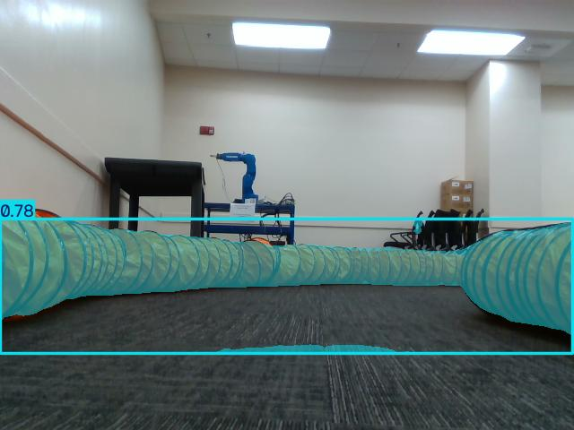
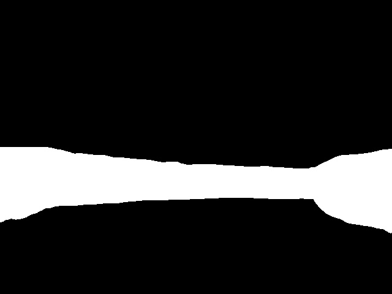
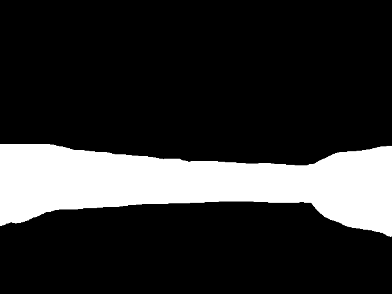
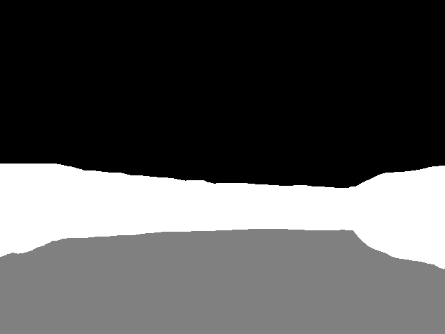

# Four stages from the same scene

**Rosbag4, frame 100, 640 × 480.** All four views show the same front-facing track scene and use the August 25, 150-epoch checkpoint included in this repository.

| 1. Blue YOLO detection | 2. Initial binary mask |
| --- | --- |
|  |  |

| 3. Geometric wall correction | 4. Drivable region |
| --- | --- |
|  |  |

White marks detected obstacles. In the final view, gray marks the region flood-filled from the bottom-center seed; black is the remaining area.

The blue overlay and initial mask are unchanged files from the August 29 `onnx_18` experiment. The corrected/final result is from the September 1 `onnx_1` experiment at the same bag frame. These compare historical processing variants of the same scene, rather than claiming all four files came from one saved run.

A separate corrected-wall image was not saved in the later run. Stage 3 exports the white obstacle pixels of its saved final mask (grayscale threshold 192), excluding the gray drivable region. No scene content was synthesized. See [provenance.json](provenance.json) for exact original paths, checksums, and the camera-message timestamp.

## Original local runs

The historical output folders remain on the original machine under:

```text
/home/samaviajaffery/airacer_basecode/blaze_racer/autonomy_ws/src/yolo_detection/
/home/samaviajaffery/airacer_basecode/blaze_racer/autonomy_ws/src/yolo_perception/
```

Within each, dated experiments use `YYYY-MM-DD/output_results_rosbags/`. The full image collections are local; these four selected images are committed here.
